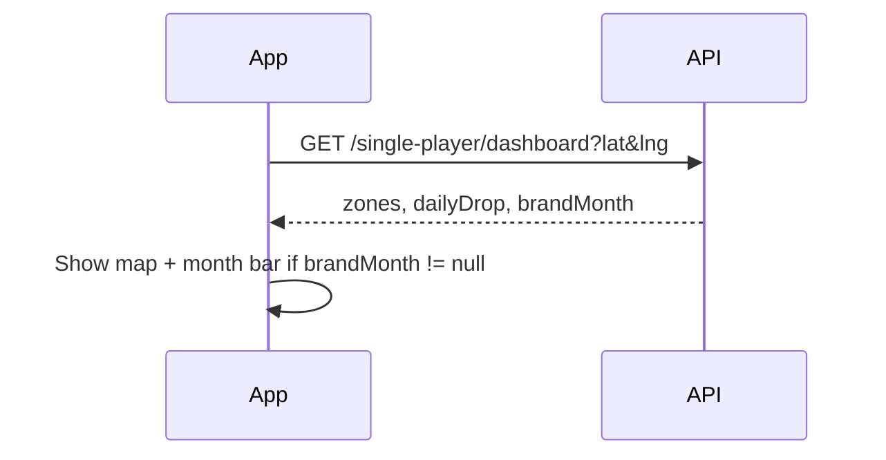
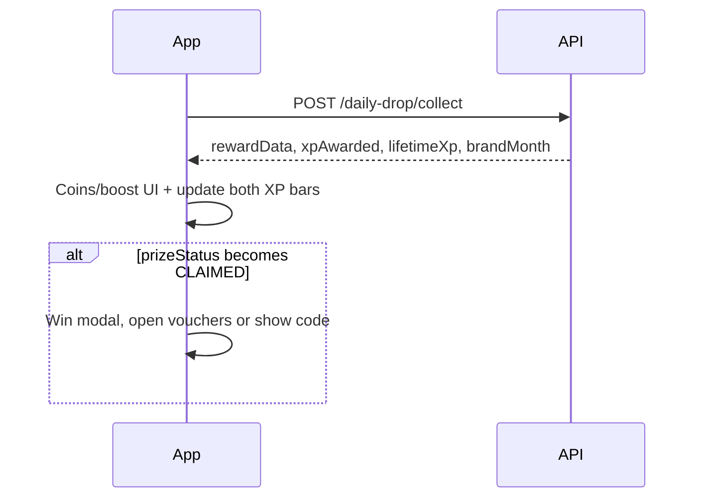

# Brand Month / XP progression — Flutter integration guide

**Audience:** Mobile app developer (Flutter).  
**Base URL:** `{BASE}/api` (e.g. `https://backend-prod.raidr-app.com/api` or `http://188.245.72.1:5001/api`).  
**Auth:** User JWT — `Authorization: Bearer <token>` on all player routes below.

OpenAPI details: `swagger.json` (tags: **Single Player**, schemas `BrandMonthClientStateDto`, `UserLifetimeXpProgressDto`).

---

## Paste this into Cursor (mobile)

```text
Integrate Brand Month using docs/FLUTTER_BRAND_MONTH_INTEGRATION.md in raidr-backend.

Rules:
- XP from POST /single-player/daily-drop/collect (and future XP sources). Grand prize: POST /single-player/brand-month/{campaignId}/claim when eligibleToClaim is true.
- Show map bar from GET /single-player/dashboard → data.brandMonth OR GET /single-player/brand-month/active.
- Dual XP: same xpAwarded updates lifetime level (lifetimeXp) AND campaign bar (brandMonth.campaignXp).
- prizeStatus: NONE | CLAIMED | SOLD_OUT. When eligibleToClaim, call POST /single-player/brand-month/{campaignId}/claim (FCFS inventory at claim time).
- Urgency copy: inventoryRemaining / inventoryTotal (e.g. "25/50 vouchers left").
- Do NOT implement milestone tiers from old mockups — backend has single xpTarget only.
```

---

## 1. Product behavior (what the app should communicate)

| Concept | Meaning for UI |
|--------|----------------|
| **Brand Month** | Time-limited season (e.g. McDonald's Month) configured by admin. |
| **Campaign XP** | Temporary bar: `campaignXp` → `xpTarget`. Resets conceptually when a **new** campaign starts (new season). |
| **Lifetime XP** | Permanent player level (`xp_earned`, `level`) — **never** resets. Same XP events feed both bars. |
| **Inventory (FCFS)** | Only the first `inventoryTotal` players who reach `xpTarget` while stock lasts win the grand prize. |
| **Claim prize** | When `eligibleToClaim === true`, call `POST /brand-month/{campaignId}/claim` (show **Claim reward** button). |
| **Sold out** | `inventoryRemaining === 0` → `allVouchersClaimed: true`. User can still earn **lifetime** XP from drops; they cannot win this month's grand prize (`prizeStatus` may become `SOLD_OUT`). |

**Important:** Collecting the **daily drop** is the only player action that awards Brand Month XP today. The collect response includes updated `brandMonth` for animations.

---

## 2. Shared data model: `BrandMonthClientState`

Returned as `data` (active/history) or `data.brandMonth` (dashboard) or root `brandMonth` (daily drop collect).  
When no campaign is active, value is **`null`**.

| Field | Type | UI use |
|-------|------|--------|
| `campaignId` | string (uuid) | Deep links, analytics |
| `name` | string | Title ("McDonald's Month") |
| `description` | string? | Subtitle |
| `brandLogoUrl` | string? | Logo |
| `startDate` | ISO datetime | "Ends in …" / season dates |
| `endDate` | ISO datetime | Same |
| `xpTarget` | int | Goal (e.g. 2000) |
| `campaignXp` | int | Current season XP |
| `xpRemaining` | int | `max(0, xpTarget - campaignXp)` |
| `progressPercent` | int | 0–100 for bar |
| `inventoryRemaining` | int | Vouchers left |
| `inventoryTotal` | int | Original pool size |
| `vouchersSoldOut` | bool | Same as stock 0 |
| `allVouchersClaimed` | bool | Show "All vouchers claimed" |
| `prizeStatus` | string | `NONE` \| `CLAIMED` \| `SOLD_OUT` |
| `eligibleToClaim` | bool | Show **Claim reward** → POST `…/brand-month/{campaignId}/claim` |
| `canStillWinPrize` | bool | Show competitive urgency |
| `rewardPreview` | object | Grand prize before win (see below) |
| `prize` | object? | Populated when `prizeStatus === CLAIMED` |
| `sponsoredThemeId` | string? | Optional link to map theme |

**`rewardPreview` / prize fields:**

| Field | Type |
|-------|------|
| `title` | string? |
| `sponsorName` | string? |
| `description` | string? |
| `imageUrl` | string? |
| `redemptionCode` | string? |

**When `prizeStatus === CLAIMED`**, `prize` also includes:

| Field | Type |
|-------|------|
| `userVoucherId` | string? | Set if reward type was catalog voucher |
| `claimedAt` | ISO datetime? |

---

## 3. Shared model: `lifetimeXp` (after daily drop collect)

| Field | Type | Meaning |
|-------|------|---------|
| `level` | int | Current player level |
| `xp_earned` | int | Lifetime total XP |
| `xp_progress` | int | XP bank toward next level |
| `nextLevel` | int | `level + 1` |
| `levelProgressPercent` | int | 0–100 for **lifetime** bar |
| `xpRequiredForNextLevel` | int | XP needed for one level step |
| `xpRemainingForNextLevel` | int | XP left to next level |

Profile / header level UI should use **`lifetimeXp`**, not `brandMonth`.

---

## 4. Player APIs (mobile)

### 4.1 `GET /single-player/dashboard`

**Purpose:** Main map load — zones, daily drop, stats, **and** Brand Month bar in one call.

**Query (required):**

| Param | Type |
|-------|------|
| `latitude` | number |
| `longitude` | number |

Optional: `city` (string).

**Success 200:**

```json
{
  "status": true,
  "data": {
    "dashboard": { "ownedZonesCount": 2, "passiveIncomePerHour": 120, "...": "..." },
    "brandMonth": { "...": "BrandMonthClientState or null" },
    "dailyDrop": { "...": "DailyDropDto or null" },
    "zones": [ "..."]
  }
}
```

**When to call:** Home map open, pull-to-refresh on map.  
**UI:** If `brandMonth != null`, show floating progression chip / bar using `progressPercent`, `inventoryRemaining`/`inventoryTotal`, `name`, `brandLogoUrl`.

**Errors:** 400 missing lat/lng; 401 unauthorized; 500 server.

---

### 4.2 `GET /single-player/brand-month/active`

**Purpose:** Full **Brand Month / progression** screen without loading entire dashboard.

**Query:** None.

**Success 200:**

```json
{
  "status": true,
  "data": {
    "campaignId": "uuid",
    "name": "McDonald's Month",
    "xpTarget": 2000,
    "campaignXp": 450,
    "progressPercent": 23,
    "inventoryRemaining": 25,
    "inventoryTotal": 50,
    "prizeStatus": "NONE",
    "canStillWinPrize": true,
    "rewardPreview": { "title": "Meal Voucher", "sponsorName": "McDonald's" },
    "prize": null
  }
}
```

**No active campaign:**

```json
{
  "status": true,
  "data": null
}
```

**When to call:** Dedicated progression screen; optional if dashboard already loaded.  
**UI copy examples:**
- Progress: `{campaignXp} / {xpTarget} XP`
- Urgency: `{inventoryRemaining}/{inventoryTotal} vouchers remaining`
- Sold out: `allVouchersClaimed === true` → disable "win prize" messaging; still show lifetime XP elsewhere

**Errors:** 401, 500.

---

### 4.3 `GET /single-player/brand-month/history`

**Purpose:** Past seasons the user participated in.

**Success 200:**

```json
{
  "status": true,
  "data": [
    { "...": "BrandMonthClientState for each campaign" }
  ]
}
```

Order: most recently updated first.  
**UI:** List with name, dates, final `campaignXp`, `prizeStatus`, `prize` if claimed.

**Errors:** 401, 500.

---

### 4.4 `POST /single-player/brand-month/{campaignId}/claim`

**Purpose:** Claim the Brand Month **grand prize** after the XP bar is full (`eligibleToClaim` on active/dashboard).

**Path:** `campaignId` = `data.campaignId` from active/history.

**Body:** none.

**Success 200:**

```json
{
  "status": true,
  "msg": "Brand Month reward claimed",
  "data": {
    "campaignId": "...",
    "prizeStatus": "CLAIMED",
    "eligibleToClaim": false,
    "prize": {
      "title": "McDonald's Meal Voucher",
      "redemptionCode": "MCD-MEAL-2026",
      "claimedAt": "2026-10-15T13:00:00.000Z",
      "userVoucherId": "..."
    }
  }
}
```

**Errors:**

| HTTP | Typical `msg` |
|------|----------------|
| 400 | Target not reached; campaign inactive; all vouchers claimed (`SOLD_OUT` in `data`) |
| 404 | Campaign not found |
| 409 | Already claimed |
| 401 | Unauthorized |

---

### 4.5 `POST /single-player/daily-drop/collect`

**Purpose:** Collect today's daily drop (coins, boost, etc.) and **award XP** (lifetime + Brand Month).

This endpoint **only** moves the month bar (XP). Use **§4.4 claim** for the grand prize when `eligibleToClaim` is true.

**Body (JSON):**

| Field | Type | Required |
|-------|------|----------|
| `dropId` | uuid | yes |
| `latitude` | number | yes |
| `longitude` | number | yes |

**Rules:** Player must be within **50 m** of drop coordinates (not zone radius).

**Success 200:**

```json
{
  "status": true,
  "msg": "You found 100 Coins!",
  "rewardData": {
    "type": "COINS",
    "amount": 100
  },
  "xpAwarded": 50,
  "lifetimeXp": {
    "level": 6,
    "xp_earned": 2450,
    "xp_progress": 450,
    "nextLevel": 7,
    "levelProgressPercent": 13,
    "xpRequiredForNextLevel": 3600,
    "xpRemainingForNextLevel": 3150
  },
  "brandMonth": {
    "campaignXp": 500,
    "xpTarget": 2000,
    "prizeStatus": "NONE"
  }
}
```

`brandMonth` may be **`null`** if no active campaign.

**UI after collect:**
1. Show drop reward from `rewardData` / `msg`.
2. Animate **+{xpAwarded} XP** (optional: show split copy — "Season +50 · Lifetime +50" — same number both sides).
3. Update local state from `lifetimeXp` and `brandMonth`.
4. If response shows `prizeStatus: CLAIMED` and `prize` filled → celebration modal + link to vouchers.

**Errors:**

| HTTP | Typical `msg` |
|------|----------------|
| 400 | Already collected, too far away, missing fields |
| 403 | Not your drop |
| 404 | Drop not found |
| 401 | Unauthorized |

---

### 4.6 `GET /single-player/game-config`

**Purpose:** Read **`dailyDropXpNormal`** and **`dailyDropXpRare`** (defaults 50 / 150) for labels like "Collect for +50 XP".

**Success 200:**

```json
{
  "status": true,
  "data": {
    "baseCaptureTimeSec": 30,
    "dailyDropXpNormal": 50,
    "dailyDropXpRare": 150,
    "...": "other gameplay fields"
  }
}
```

**When to call:** App startup or cache with dashboard; optional on daily drop pin tooltip.

---

### 4.7 `GET /single-player/vouchers`

**Purpose:** User's won vouchers (includes Brand Month wins when `rewardType` was **COMMERCIAL_VOUCHER**).

**Success 200:**

```json
{
  "status": true,
  "data": [
    {
      "id": "user-voucher-uuid",
      "voucherId": "catalog-uuid",
      "isRedeemed": false,
      "voucher": {
        "title": "Free Coffee",
        "sponsorName": "McDonald's",
        "redemptionCode": "MCD-COFFEE-001",
        "imageUrl": "https://..."
      }
    }
  ]
}
```

**INLINE** campaign prizes may appear only in `brandMonth.prize` / history — not always in this list. Show redemption code from `prize.redemptionCode` on progression screen when `CLAIMED`.

---

### 4.8 `GET /single-player/theme` (optional branding)

**Purpose:** Map/drop skin during sponsored period.

If active Brand Month has `sponsoredThemeId`, theme may come from linked **Sponsored Theme** before generic theme.

**Query (optional):** `lat`, `lng` — required when theme is geo-fenced.

**Success 200:** `{ "status": true, "data": SponsoredTheme | null }`

Use for map overlay / drop art alongside `brandMonth.brandLogoUrl`.

---

## 5. Admin-only APIs (reference — not built in consumer app)

Campaigns are created in **admin panel / Postman**, not in the player app. Documented so mobile knows what drives `brandMonth` fields.

| Method | Path | Notes |
|--------|------|--------|
| POST | `/admin/brand-months` | Create campaign |
| GET | `/admin/brand-months` | List |
| GET | `/admin/brand-months/:id` | Detail |
| PUT | `/admin/brand-months/:id` | Update stock, dates, etc. |
| DELETE | `/admin/brand-months/:id` | Remove |
| POST | `/admin/vouchers` | Catalog voucher for `COMMERCIAL_VOUCHER` campaigns |
| PUT | `/admin/single-player/config` | Set `dailyDropXpNormal`, `dailyDropXpRare` |

Admin auth: `POST /admin/login` → Bearer **admin** token.

---

## 6. Recommended app flows

### 6.1 Map (home)



### 6.2 Collect daily drop



### 6.3 Progression screen

1. `GET /single-player/brand-month/active`  
2. If `data == null` → empty state "No active season"  
3. Else render full layout: logo, `{campaignXp}/{xpTarget}`, stock counter, `rewardPreview`, `prize` if claimed  

Optional: `GET /single-player/brand-month/history` on sub-tab.

---

## 7. `prizeStatus` UI matrix

| Status | Meaning | UI |
|--------|---------|-----|
| `NONE` | Still racing toward target (or below target) | Normal bar + urgency |
| `CLAIMED` | User won grand prize | Show `prize`, code, link to wallet/vouchers |
| `SOLD_OUT` | User reached target **after** stock empty, or marked when target met but no stock | "All vouchers claimed" — no prize for user; lifetime XP continues |

Use `canStillWinPrize` to show/hide competitive messaging.

---

## 8. Integration checklist (Flutter)

- [ ] Parse `brandMonth` on dashboard; handle `null`.
- [ ] After daily drop collect, merge `lifetimeXp` into profile state and `brandMonth` into season state.
- [ ] Progression screen uses `/brand-month/active` or cached dashboard data.
- [ ] Show `inventoryRemaining / inventoryTotal` on bar (FOMO).
- [ ] Do **not** send `milestones` in any request (not supported).
- [ ] Handle `COMMERCIAL_VOUCHER` wins via `/single-player/vouchers` + `prize.userVoucherId`.
- [ ] Handle `INLINE` wins via `prize.redemptionCode` on progression/history.
- [ ] Read `dailyDropXpNormal` / `dailyDropXpRare` from game-config for labels.
- [ ] Swagger + this doc kept in sync when backend changes.

---

## 9. Related docs

| File | Purpose |
|------|---------|
| [FLUTTER_SINGLE_PLAYER_INTEGRATION.md](./FLUTTER_SINGLE_PLAYER_INTEGRATION.md) | Daily drop spawn, dashboard, zones |
| [FRONTEND_SINGLE_PLAYER_V2.md](./FRONTEND_SINGLE_PLAYER_V2.md) | Screen → endpoint map |
| [POSTMAN_SINGLE_PLAYER_V2.md](./POSTMAN_SINGLE_PLAYER_V2.md) | QA sequences |
| [BRAND_MONTH_XP.md](./BRAND_MONTH_XP.md) | Backend / ops summary |

---

## 10. Example copy (EN)

| Situation | Suggested string |
|-----------|------------------|
| Bar | `{name}: {campaignXp} / {xpTarget} XP` |
| Stock | `{inventoryRemaining} of {inventoryTotal} vouchers left` |
| Sold out | `All vouchers claimed — keep playing for XP and levels` |
| Win | `You unlocked {rewardPreview.title}!` |
| Collect | `+{xpAwarded} XP` |
