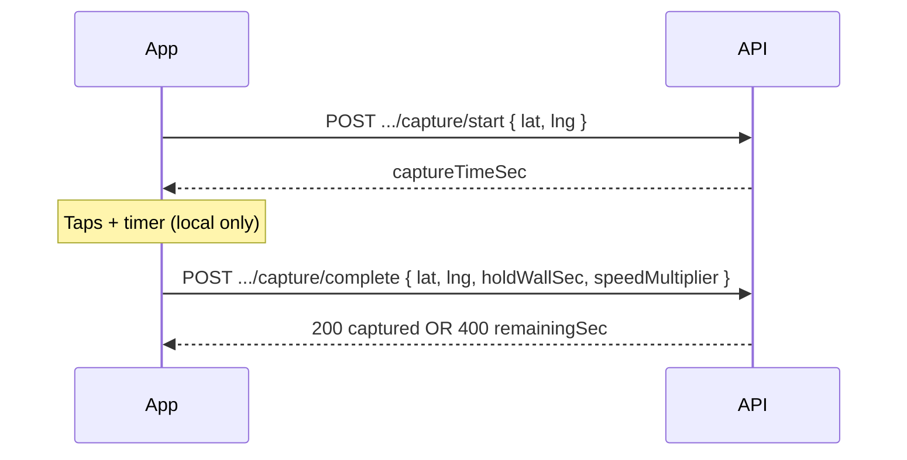

# Capture snatch — client hold sync (2× speed)

**For:** Flutter developer  
**Base URL:** `https://backend.raidr-app.com/api` (or dev `http://188.245.72.1:5002/api`)  
**Auth:** `Authorization: Bearer <JWT>`

**Model:** **3 HTTP calls per snatch** — `start` → local hold (taps + UI) → **`complete` with hold summary**.  
No per-tap API. **No periodic ping** (optional only if you want mid-snatch radius checks).

---

## Paste into Cursor

```text
Implement zone snatch per raidr-backend/docs/FLUTTER_CAPTURE_HOLD_SYNC.md

- POST capture/start { latitude, longitude }
- Local Stopwatch → holdWallSec; local speedMultiplier 1.0–2.0 from taps (~4 taps/s → 2.0)
- Local UI: countdown/bar from captureTimeSec, holdWallSec, speedMultiplier (client only)
- When local hold is done (holdWallSec × speedMultiplier >= captureTimeSec): POST capture/complete with:
  { latitude, longitude, holdWallSec, speedMultiplier }
- Do NOT call capture/ping on a timer (optional: ping only if user leaves zone / debug)
- On complete 400: show remainingSec from server; let user keep holding and retry complete
```

---

## Flow (end-only sync)



---

## Endpoints

| Step | Method | Path |
|------|--------|------|
| Start | `POST` | `/single-player/zones/:zoneId/capture/start` |
| **Finish** | `POST` | `/single-player/zones/:zoneId/capture/complete` |
| Abort | `POST` | `/single-player/zones/:zoneId/capture/cancel` |
| Optional | `POST` | `/single-player/zones/:zoneId/capture/ping` | Mid-snatch radius only — **not required** |

---

## Request: `capture/complete` (2× hold summary)

```json
{
  "latitude": 33.5654935,
  "longitude": 73.1502127,
  "holdWallSec": 30,
  "speedMultiplier": 2
}
```

| Field | Rule |
|--------|------|
| `latitude`, `longitude` | Required — must be in zone radius |
| `holdWallSec` | Wall seconds since **`capture/start`**, cumulative |
| `speedMultiplier` | Required with `holdWallSec`. **1.0 … 2.0** |

**Always send `holdWallSec` + `speedMultiplier` on complete** for the client-hold model.

---

## When to call complete (client)

Enable your “Complete” action when **locally**:

```text
holdWallSec × speedMultiplier >= captureTimeSec
```

Then call **`capture/complete`** once with the same numbers.

If server returns **400** with `remainingSec`, show it and let the user hold longer (then call complete again with updated `holdWallSec`).

---

## Server math

```
effectiveHoldSec = min(captureTimeSec, holdWallSec × speedMultiplier)
```

| captureTimeSec | holdWallSec | speedMultiplier | Server |
|----------------|-------------|-----------------|--------|
| 60 | 30 | 2 | Accept complete |
| 60 | 25 | 2 | 400, remainingSec > 0 |
| 90 | 45 | 2 | Accept complete |

`holdWallSec` cannot exceed real time since `capture/start` (~+3 s slack).

---

## Success `complete` (200)

Standard capture success payload (`shieldExpiresAt`, `ownedAt`, passive blocks, etc.).

---

## Failure `complete` (400) — timer not met

```json
{
  "status": false,
  "msg": "Capture time not met. Hold position until the timer completes.",
  "remainingSec": 12,
  "speedMultiplier": 1
}
```

User keeps snatching; retry **`complete`** with updated `holdWallSec` / `speedMultiplier`.

---

## Client checklist

- [ ] `capture/start` → store `captureTimeSec`, start stopwatch.
- [ ] Taps → local speed only (**no HTTP**).
- [ ] Progress bar → **local** using `captureTimeSec`, `holdWallSec`, `speedMultiplier`.
- [ ] When local hold satisfied → **one** `capture/complete` with GPS + `holdWallSec` + `speedMultiplier`.
- [ ] **Do not** ping every 3–5 s unless you need live server countdown.
- [ ] Out of radius on `complete` → 400 message; prompt user to move back.
- [ ] `capture/cancel` if user aborts.

---

## Legacy

| Pattern | Status |
|---------|--------|
| Ping every few seconds with `holdWallSec` | Optional; still supported |
| `capture/taps` per tap | Deprecated |

---

## Related

- [FLUTTER_SINGLE_PLAYER_INTEGRATION.md](./FLUTTER_SINGLE_PLAYER_INTEGRATION.md) § Capture  
- OpenAPI: `capture/start`, `capture/complete`