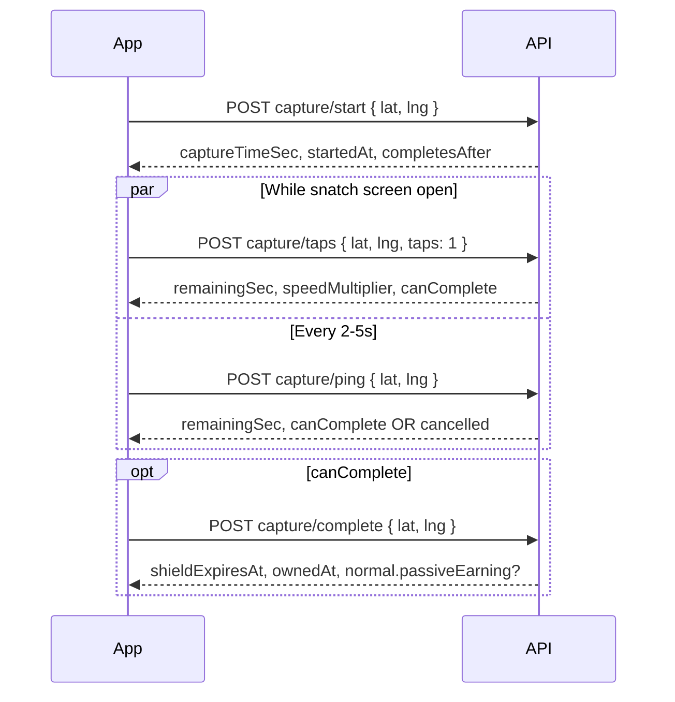

# Capture tap acceleration (Flutter implementation)

**Audience:** Flutter / mobile developer (or Cursor agent).  
**Backend:** `raidr-backend` — all routes under **`/api`**.  
**Feature:** Rapid tapping during zone snatch speeds up the hold timer on the **server** (up to **2×**). The app must **not** run its own accelerated countdown.

**Related docs:** [FLUTTER_SINGLE_PLAYER_INTEGRATION.md](./FLUTTER_SINGLE_PLAYER_INTEGRATION.md) §3.2 Capture, [FRONTEND_NORMAL_ZONE_COIN_PROGRESS.md](./FRONTEND_NORMAL_ZONE_COIN_PROGRESS.md), OpenAPI `swagger.json` → `ActiveCaptureSession`, path `/single-player/zones/{id}/capture/taps`.

---

## Paste into Cursor

```text
Implement snatch tap acceleration per:
docs/FLUTTER_CAPTURE_TAP_ACCELERATION.md

Rules:
- Base URL: {BASE}/api
- Auth: Authorization: Bearer <user JWT>
- On snatch screen: POST capture/taps on user tap (with lat/lng); POST capture/ping every 2–5s
- Do NOT compute remaining time or speed locally — bind UI to server remainingSec, captureProgressPercent, speedMultiplier
- Do NOT send speedMultiplier from client
- Enable Complete only when server canComplete === true or eligibleToComplete === true
- On 429 from taps: ignore burst, keep UI on last good server values
- On ping/taps cancelled: true — exit snatch UI
```

---

## Product summary (easy language)

1. Player starts capture → server stores a session and total hold time (`captureTimeSec`).
2. While holding, **tapping faster** makes the server count down **faster** (multiplier **1.0 → 2.0**).
3. **4+ valid taps per second** (in the server’s last-1-second window) → **2×** speed.
4. **`capture/complete`** only succeeds when the **server** says time is up — not when a local timer hits zero.

Guards, cancel, shields, and base capture duration are unchanged.

---

## Endpoints (snatch flow)

All **Private** — `Authorization: Bearer {{userToken}}`, `Content-Type: application/json`.

| Step | Method | Path | When |
|------|--------|------|------|
| Start | `POST` | `/single-player/zones/:id/capture/start` | Player starts snatch in radius |
| **Tap** | `POST` | `/single-player/zones/:id/capture/taps` | Each tap (or throttled batches) on snatch UI |
| Ping | `POST` | `/single-player/zones/:id/capture/ping` | Every **2–5 s** while screen open (GPS + sync) |
| Optional | `POST` | `/single-player/zones/:id/capture/eliminate-guards` | AR guard flow (unchanged) |
| Finish | `POST` | `/single-player/zones/:id/capture/complete` | When `canComplete` / `eligibleToComplete` |
| Cancel | `POST` | `/single-player/zones/:id/capture/cancel` | User leaves / abort |
| Refresh | `GET` | `/single-player/zones/:id?latitude=&longitude=` | Optional; `activeCaptureSession` on zone |

Full path prefix: **`/api/single-player/zones/{zoneId}/capture/...`**

---

## Request / response examples

### `POST .../capture/taps`

**Request**

```json
{
  "latitude": 40.7829,
  "longitude": -73.9654,
  "taps": 1
}
```

- `taps` is optional (default **1**). Max **8** per request (server enforced).
- Always send current GPS (same as ping).

**200 OK**

```json
{
  "status": true,
  "inRadius": true,
  "tapsAccepted": 1,
  "tapsRejected": 0,
  "remainingSec": 18,
  "speedMultiplier": 2,
  "tapRate": 5,
  "tapCount": 120,
  "eligibleToComplete": false,
  "canComplete": false,
  "captureProgressPercent": 40,
  "sessionGuardsRemaining": 2
}
```

| Field | UI use |
|-------|--------|
| `remainingSec` | Big countdown number |
| `captureProgressPercent` | Timer progress bar (0–100) |
| `speedMultiplier` | Optional “2×” badge / haptics when ≥ 1.5 |
| `tapRate` | Debug / optional intensity FX |
| `canComplete` | Enable **Complete capture** button |
| `tapsAccepted` / `tapsRejected` | Optional analytics |

**429** — tap requests too fast (wait ~30–50 ms between calls):

```json
{
  "status": false,
  "msg": "Tap requests too frequent. Slow down slightly.",
  "remainingSec": 18,
  "speedMultiplier": 2,
  "canComplete": false
}
```

**400** — left zone:

```json
{
  "status": false,
  "msg": "Left zone radius — capture cancelled.",
  "cancelled": true
}
```

---

### `POST .../capture/ping`

Same body as before: `{ "latitude", "longitude" }`.

**200** now also includes tap acceleration fields:

```json
{
  "status": true,
  "inRadius": true,
  "remainingSec": 22,
  "speedMultiplier": 1.25,
  "tapRate": 1,
  "tapCount": 15,
  "eligibleToComplete": false,
  "canComplete": false,
  "captureProgressPercent": 27,
  "sessionGuardsRemaining": 0,
  "showGuardElimination": false
}
```

Use ping when the user is **not** tapping (background hold) so radius and timer stay in sync.

---

### `GET .../zones/:id` → `activeCaptureSession`

When a session exists, the zone payload includes:

```json
"activeCaptureSession": {
  "captureTimeSec": 170,
  "remainingSec": 45,
  "captureProgressPercent": 73,
  "elapsedSec": 125,
  "eligibleToComplete": false,
  "canComplete": false,
  "tapCount": 80,
  "tapRate": 2,
  "speedMultiplier": 1.5,
  "sessionGuardsRemaining": 1,
  "showGuardElimination": true
}
```

Refresh after ping/taps or when re-opening the snatch screen.

---

### `POST .../capture/complete`

Unchanged body: `{ "latitude", "longitude" }`.

Call only when **`canComplete === true`** (or `eligibleToComplete`).

**400** if server timer not done:

```json
{
  "status": false,
  "msg": "Capture time not met. Hold position until the timer completes.",
  "remainingSec": 12,
  "speedMultiplier": 1
}
```

---

## Sequence (recommended)



---

## Client implementation guide

### 1. State model

Hold **server-authored** timer state on the snatch screen:

```dart
class CaptureTimerViewState {
  final int captureTimeSec;       // from start or session
  final int remainingSec;
  final int captureProgressPercent;
  final double speedMultiplier;
  final double tapRate;
  final int tapCount;
  final bool canComplete;
  final bool showGuardElimination;
  final int sessionGuardsRemaining;

  // Update only from capture/start, taps, ping, GET zone activeCaptureSession, eliminate-guards
}
```

**Do not** decrement `remainingSec` with a local `Timer.periodic` unless you use it **only** for smooth animation between server syncs — always **reconcile** on every API response.

### 2. Tap → API

- On tap gesture: fire `POST .../capture/taps` with `taps: 1`.
- **Throttle** outgoing tap requests (e.g. max one in flight, or min **30–50 ms** between calls) to avoid **429**.
- Use latest GPS from your location stream.
- On success: `setState` from response fields.
- On **429**: keep previous UI; optional light haptic “too fast”.
- On **`cancelled: true`**: pop snatch screen, show `msg`.

### 3. Ping loop

- `Timer` or `Stream.periodic` every **2–5 seconds** → `capture/ping`.
- Run in parallel with taps (ping does not replace taps).
- If app backgrounds, expect session loss; on resume, `GET zone` or retry start.

### 4. Progress bar & copy

| Widget | Field |
|--------|--------|
| Bar fill | `captureProgressPercent` / 100 |
| Countdown label | `remainingSec` |
| “2×” indicator | `speedMultiplier >= 1.99` (or `>= 1.5` for softer UX) |
| Complete button | `enabled: canComplete` |

### 5. Complete capture

```dart
if (state.canComplete) {
  await api.postCaptureComplete(zoneId, lat, lng);
}
```

Never enable complete based on a client-only countdown.

### 6. Optional local smoothing (advanced)

If you want a smooth countdown between network round-trips:

- On each server response, store `remainingSec` and `receivedAt`.
- Display: `max(0, remainingSec - floor((now - receivedAt) * speedMultiplier))` **only as interpolation**.
- Every taps/ping overwrites with authoritative values.

---

## Server rules (what Flutter must respect)

| Rule | Detail |
|------|--------|
| Source of truth | `remainingSec`, `canComplete`, `speedMultiplier` from API only |
| Speed range | `speedMultiplier` ∈ **1.0 … 2.0** |
| 2× threshold | ~**4 taps/sec** in server’s 1 s window |
| Max batch | `taps` ≤ **8** per request |
| Anti-spam | Very fast tap **requests** → **429** |
| Radius | Out of radius on taps/ping → session cleared, `cancelled: true` |
| Guards | Eliminate still shortens total time; timer math uses server elapsed |

---

## Error handling checklist

- [ ] `400` + `cancelled: true` → exit snatch, clear local session state  
- [ ] `400` “No active capture attempt” → return to zone detail, offer restart  
- [ ] `429` on taps → backoff, do not stack fake local speed  
- [ ] `complete` `400` with `remainingSec` → keep snatch UI, show seconds left from server  
- [ ] `409` on complete → owner changed; refresh zone  

---

## Testing checklist (QA)

1. Start capture on NORMAL zone → `captureTimeSec` matches breakdown.
2. Tap rapidly for 10 s → `speedMultiplier` rises toward **2.0**; `remainingSec` drops faster than 1× wall clock.
3. Stop tapping → multiplier decays toward **1.0** within ~1 s.
4. When `canComplete` → complete succeeds without waiting full wall-clock duration.
5. Complete **before** `canComplete` → **400** with `remainingSec`.
6. Walk out of radius during taps → **cancelled**.
7. Guard eliminate flow still works; timer fields update on eliminate response.

---

## Files to touch in Flutter (suggested)

| Area | Change |
|------|--------|
| API client | Add `postCaptureTaps(zoneId, lat, lng, {taps})` |
| Snatch screen | Tap handler → taps endpoint; bind bar to `captureProgressPercent` |
| Snatch controller/bloc | Merge pings + taps into one `CaptureTimerViewState` |
| Models | Extend `ActiveCaptureSession` with `tapCount`, `tapRate`, `speedMultiplier`, `canComplete` |

---

## Changelog

| Date | Backend |
|------|---------|
| 2026-03 | Added `POST .../capture/taps`; ping/complete/session use accelerated elapsed time |
