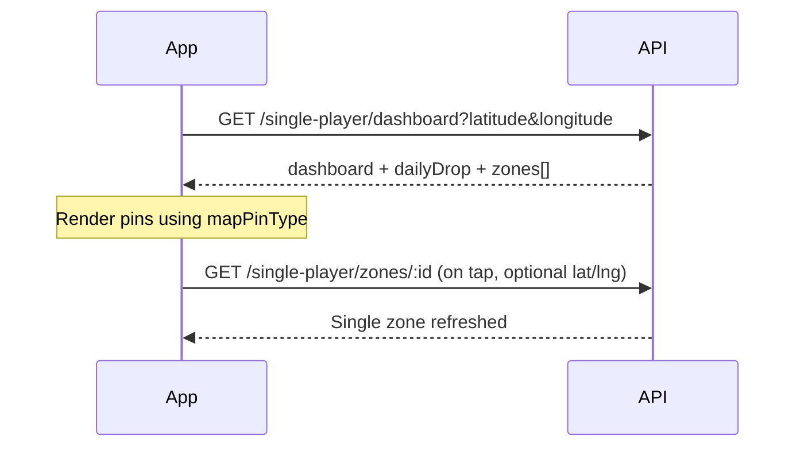
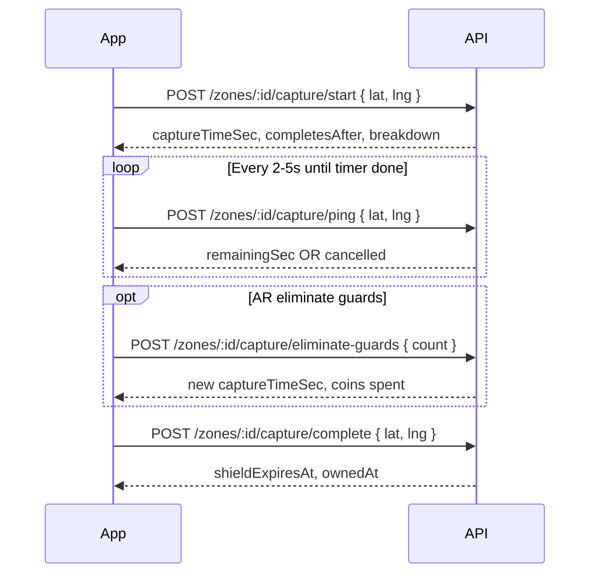
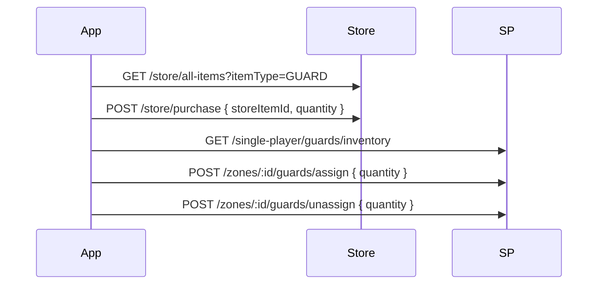

# Single Player V2 — Flutter integration guide (full API reference)

**Audience:** Flutter developer (or Cursor agent integrating the Raidr mobile app).  
**Backend repo:** `raidr-backend` — all routes below are mounted under **`/api`**.

---

## How to use this doc with Cursor

Paste this block into Cursor when starting Single Player work:

```text
Integrate Raidr Single Player V2 using the backend contract in:
docs/FLUTTER_SINGLE_PLAYER_INTEGRATION.md

Rules:
- Base URL: {BASE}/api (e.g. https://api.example.com/api)
- Auth: Authorization: Bearer <user JWT> on every route marked Private
- JSON envelope: success uses status: true; errors use status: false and msg (string)
- GPS: send latitude/longitude as numbers (double), not strings
- Capture flow requires Redis on server; poll POST .../capture/ping every 2–5s while holding
- Guards: buy via GET /store/all-items?itemType=GUARD + POST /store/purchase — NOT /single-player/guards/purchase (410)
- Map: prefer GET /single-player/dashboard on home map; refresh zone detail with GET /single-player/zones/:id
- OpenAPI: swagger.json in repo root (run node scripts/patch-swagger-user-single-player.js after backend updates)
```

**Related files in this repo:**

| File | Purpose |
|------|---------|
| `docs/FLUTTER_SINGLE_PLAYER_INTEGRATION.md` | This document — contract + flows |
| `docs/POSTMAN_SINGLE_PLAYER_V2.md` | Postman sequences (admin/merchant/user) |
| `docs/FRONTEND_SINGLE_PLAYER_V2.md` | Short screen → endpoint map |
| `swagger.json` | Machine-readable schemas + examples |

**Server prerequisites:** PostgreSQL migrated, **Redis running** (capture session keys).

---

## 1. Global conventions

### 1.1 Authentication

| Item | Value |
|------|--------|
| Header | `Authorization: Bearer <token>` |
| Login (user) | `POST /api/user/login` — use returned token on all Single Player routes |
| Missing/invalid token | **401** `{ "status": false, "msg": "Not authorized, token failed" }` (wording may vary slightly) |

### 1.2 Response envelope

**Success (typical):**

```json
{
  "status": true,
  "data": { }
}
```

Some endpoints add `msg`, or put fields at root (e.g. capture start returns `captureTimeSec` at root).

**Error (typical):**

```json
{
  "status": false,
  "msg": "Human-readable reason"
}
```

Some **403** responses include extra fields (`ownedZonesCount`, `maxOwnedZonesPerPlayer`) — parse `msg` for UI and use extras for counters.

**HTTP status:** Always check status code **and** `status` in body.

### 1.3 Coordinates & discovery

- **Query params:** `latitude`, `longitude` (dashboard, zones list) or `lat`, `lng` (theme only).
- **Body:** `latitude`, `longitude` for capture and daily drop.
- User location may be synced from headers/query via backend helpers — still send lat/lng on map APIs.
- **Zone radius:** Each zone has `radius` (meters). Player must be within `radius` to start/complete capture or collect daily drop (collect uses **50m** fixed, not zone radius).
- **Map visibility:** Zones outside discovery radius are hidden unless you own them. **`GET /zones?status=conquered_by_me`** returns all owned zones globally (no distance filter).

Optional query: `city` (string) for city-scoped visibility where configured.

### 1.4 Pagination (zones list & store)

```json
{
  "pagination": {
    "total": 42,
    "page": 1,
    "limit": 10,
    "totalPages": 5
  }
}
```

Store uses `hasNextPage` instead of `totalPages`.

### 1.5 Dates

ISO-8601 strings from server, e.g. `"2026-10-12T14:30:00.000Z"`. Use `DateTime.parse` in Dart.

---

## 2. Shared data models (Dart-oriented)

### 2.1 `CaptureTimeBreakdown`

| Field | Type | Meaning |
|-------|------|---------|
| `baseSec` | int | Base hold time from config |
| `ownershipDefenseSec` | int | +10 sec per full day current owner held zone (configurable) |
| `guardPenaltySec` | int | `guardCount * secondsPerGuard` |
| `guardCount` | int | Guards on zone (capped by max) |

**Total capture time** = sum of the three sec fields = `captureTimeSec` on zone object.

### 2.2 `SinglePlayerZone` (client-formatted)

Returned from dashboard, zones list, and zone detail after `formatSinglePlayerZoneForClient`.

| Field | Type | UI usage |
|-------|------|----------|
| `id` | string (uuid) | Deep links, capture path param |
| `name` | string | Labels |
| `latitude`, `longitude` | number | Map pin |
| `radius` | int | Geofence circle |
| `coinsPerHour` | int | Passive income chip |
| `imageUrl` | string? | Zone art |
| `zoneType` | `"NORMAL"` \| `"B2B"` | B2B layouts |
| `brandLogoUrl` | string? | B2B branding |
| `currentOwnerId` | string? | null = neutral |
| `shieldExpiresAt` | string? | Countdown while shield active |
| `ownedAt` | string? | "Held for X days" |
| `guardCount` | int | Defense UI |
| `maxGuardsPerZone` | int | Cap (default 5) |
| `status` | `available` \| `conquered_by_me` \| `conquered_by_others` | Filters / copy |
| `mapPinType` | see table below | Map legend icon |
| `isShieldActive` | bool | Shield UI |
| `isAttackable` | bool | Can start capture |
| `captureTimeSec` | int | Enemy snatch timer length |
| `captureTimeBreakdown` | object | Breakdown sheet |
| `defenseBonusSec` | int | Your zone: ownership + guards |
| `minOwnedZonesRequired` | int? | B2B campaign gate |
| `eligibilityNote` | string? | Marketing copy |
| `meetsEligibility` | bool? | null if unknown; false = cannot capture B2B yet |
| `b2b` | object? | null unless B2B zone |
| `owner` | `{ id, name, photoUrl? }? | Enemy/your profile snippet |

**Dashboard-only extra on each zone:** `isConquered` (bool) — same as you owning it.

#### `mapPinType`

| Value | When |
|-------|------|
| `YOUR_ZONE` | You own (non-B2B pin styling may still use zone type) |
| `NEUTRAL` | No owner |
| `B2B` | `zoneType === B2B` (takes precedence on map legend) |
| `VULNERABLE` | Owned by other, shield down |
| `ENEMY_SHIELDED` | Owned by other, shield up |

#### `b2b` block (when `zoneType === B2B`)

| Field | Type | Meaning |
|-------|------|---------|
| `rewardType` | `DIGITAL_COUPON` \| `PHYSICAL` \| `CASH` | Reward category |
| `rewardTitle` | string | Headline |
| `rewardDescription` | string? | Body |
| `rewardImageUrl` | string? | Hero image |
| `hold` | object? | null if hold not started |
| `canClaim` | bool | true when hold complete **and** you own zone |

#### `b2b.hold`

| Field | Type | Meaning |
|-------|------|---------|
| `holdDurationHours` | number | Target (e.g. 72) |
| `holdElapsedHours` | number | Progress |
| `holdComplete` | bool | Timer done |
| `holdStartedAt` | string | Starts when you **capture** B2B zone |
| `progressPercent` | int | 0–100 for progress bar |
| `holdRemainingSeconds` | int | Countdown |

### 2.3 `DashboardStats`

| Field | Type | Meaning |
|-------|------|---------|
| `ownedZonesCount` | int | Zones you own worldwide |
| `maxOwnedZonesPerPlayer` | int? | Cap (default 5); null = unlimited |
| `empireVipMinOwnedZones` | int | VIP threshold (default 5) |
| `isVip` | bool | `ownedZonesCount >= empireVipMinOwnedZones` |
| `vipRewardMultiplier` | number | Passive income multiplier when VIP |
| `passiveIncomePerHour` | int | Sum of `coinsPerHour` × boosts × VIP |
| `daysUntilNextRareDrop` | int | Placeholder (currently fixed **3** in API) |

**Note:** VIP (`isVip`) is **not** the same as “at cap”. Cap blocks **new captures**; VIP boosts **passive income**.

### 2.4 `DailyDrop` (dashboard shape)

| Field | Type | Meaning |
|-------|------|---------|
| `id` | string | For collect API |
| `latitude`, `longitude` | number | Map pin |
| `isCollected` | bool | Hide if true |
| `isRare` | bool | Rare styling |
| `distanceMeters` | int | From user to drop |
| `isNewlySpawned` | bool | First open today animation |
| `createdAt`, `updatedAt` | string | — |

Reward type is **not** exposed on dashboard object — use collect response or history. Spawn logic uses `rewardType` internally (`100_COINS`, `2X_BOOST_24H`, etc.).

### 2.5 `SinglePlayerB2bClaim`

| Field | Type | Meaning |
|-------|------|---------|
| `id` | string | Redeem path param |
| `zoneId` | string | Source zone |
| `holdStartedAt` | string | Hold streak id |
| `rewardType`, `rewardTitle`, `rewardDescription` | | Snapshot at claim time |
| `claimCode` | string? | Show for DIGITAL_COUPON / merchant |
| `isRedeemed` | bool | |
| `redeemedAt` | string? | |
| `createdAt` | string | |
| `zone` | `{ id, name, b2bRewardImageUrl?, brandLogoUrl? }` | List UI |

### 2.6 `rewardData` (daily drop collect)

Discriminate on `type`:

| type | Fields |
|------|--------|
| `COINS` | `amount` |
| `BOOST` | `multiplier`, `expiresAt` |
| `INSTANT_CAPTURE` | `amount` |
| `AVATAR` | `frontUrl`, `backUrl` |
| `VOUCHER` | `redemptionCode`, `title`, `sponsor`, `imageUrl` |

---

## 3. User flows (sequence)

### 3.1 Home map (recommended)



Poll dashboard on location change (debounced) or pull-to-refresh.

### 3.1b Real-time WebSocket (zone owner)

Connect to the existing live tracking socket (same as events / coin rush):

- **URL:** `ws://{HOST}:{WS_PORT}/live-tracking?token={userJWT}` (default port **3001**, env `WS_PORT`)
- On connect, the server subscribes the socket to **`user:{yourUserId}`** automatically.

**When someone starts capturing your zone:**

```json
{
  "type": "single_player_zone_under_attack",
  "zoneId": "uuid",
  "zoneName": "Central Park",
  "zoneGuardCount": 5,
  "attacker": { "id": "uuid", "name": "Alex", "photoUrl": null },
  "initialGuardCount": 5,
  "at": "2026-10-13T12:00:00.000Z"
}
```

**When an attacker eliminates guard(s) during their capture attempt:**

```json
{
  "type": "single_player_guard_eliminated",
  "zoneId": "uuid",
  "zoneName": "Central Park",
  "zoneGuardCount": 5,
  "attacker": { "id": "uuid", "name": "Alex", "photoUrl": null },
  "guardsEliminatedThisAction": 1,
  "guardsEliminatedInSession": 2,
  "sessionGuardsRemaining": 3,
  "initialGuardCount": 5,
  "allGuardsClearedInSession": false,
  "at": "2026-10-13T12:01:00.000Z"
}
```

**Owner UI note:** `zoneGuardCount` stays your deployed defense (DB). Progress fields describe **that attacker’s session** (each raider clears their own copy; not shared). Use events to animate “hits” and show “under attack — cannot assign guards” (API returns **409** on assign/unassign while attacked).

---

### 3.2 Capture / snatch



**Client rules:**

1. Disable start if `!isAttackable` or own zone or B2B with `meetsEligibility === false`.
2. Show timer from `captureTimeSec` / `remainingSec`; server is source of truth.
3. If ping returns `cancelled: true`, exit capture UI and show `msg`.
4. On app background, ping may fail — expect session expiry (`No active capture attempt`).
5. User can `POST .../capture/cancel` to abandon.

### 3.3 Guards



### 3.4 B2B hold & claim

1. Capture B2B zone → server sets `holdStartedAt`.
2. Poll zone detail → `b2b.hold.progressPercent`, `canClaim`.
3. When `canClaim === true` → `POST /zones/:id/b2b/claim`.
4. Wallet UI → `GET /b2b/claims`.
5. Optional user tap “I used this” → `POST /b2b/claims/:claimId/redeem`.

---

## 4. API reference (every user endpoint)

Unless noted: **Private**, header `Authorization: Bearer <token>`, `Content-Type: application/json` for bodies.

---

### 4.1 `GET /single-player/game-config`

**When:** App launch / settings; cache locally and refresh periodically.

**Query:** none

**200 OK**

```json
{
  "status": true,
  "data": {
    "baseCaptureTimeSec": 30,
    "shieldDurationMin": 60,
    "ownershipDefenseSecPerDay": 10,
    "secondsPerGuard": 30,
    "maxGuardsPerZone": 5,
    "guardPurchaseCoinPrice": 100,
    "guardEliminationCoinPrice": 50,
    "empireVipMinOwnedZones": 5,
    "vipRewardMultiplier": 1,
    "maxOwnedZonesPerPlayer": 5,
    "shieldWarningMinutesBefore": 15,
    "rivalryMilestoneHours": [24, 48],
    "allowedHoldDurationHours": [24, 48, 72]
  }
}
```

| Error | Body |
|-------|------|
| 401 | `{ "status": false, "msg": "..." }` |
| 500 | `{ "status": false, "msg": "..." }` |

---

### 4.2 `GET /single-player/dashboard`

**When:** Main Single Player map screen (primary data source).

**Query (required):**

| Param | Type | Required |
|-------|------|----------|
| `latitude` | number | yes |
| `longitude` | number | yes |
| `city` | string | no |

**200 OK**

```json
{
  "status": true,
  "data": {
    "dashboard": {
      "ownedZonesCount": 2,
      "maxOwnedZonesPerPlayer": 5,
      "empireVipMinOwnedZones": 5,
      "isVip": false,
      "vipRewardMultiplier": 1,
      "passiveIncomePerHour": 120,
      "daysUntilNextRareDrop": 3
    },
    "dailyDrop": {
      "id": "uuid",
      "userId": "uuid",
      "latitude": 40.783,
      "longitude": -73.966,
      "isCollected": false,
      "isRare": false,
      "createdAt": "2026-10-12T00:00:00.000Z",
      "updatedAt": "2026-10-12T00:00:00.000Z",
      "distanceMeters": 85,
      "isNewlySpawned": true
    },
    "zones": [ "/* SinglePlayerZone + isConquered */" ]
  }
}
```

`dailyDrop` may be `null` only in edge cases; normally created for today automatically.

| Error | Body |
|-------|------|
| 400 | `{ "status": false, "msg": "Latitude and longitude are required in query params" }` |
| 401 / 500 | standard |

**Flutter:** Show `ownedZonesCount/maxOwnedZonesPerPlayer` as “2/5 zones”. Block capture CTA when count >= max.

---

### 4.3 `GET /single-player/zones`

**When:** Zone list screens (My Raids filters), pagination.

**Query:**

| Param | Type | Default | Notes |
|-------|------|---------|-------|
| `latitude` | number | — | Required for map discovery (except `status=conquered_by_me`) |
| `longitude` | number | — | |
| `status` | string | — | `available`, `conquered_by_me`, `conquered_by_others` |
| `page` | int | 1 | |
| `limit` | int | 10 | |
| `city` | string | — | optional |

**200 OK**

```json
{
  "status": true,
  "data": [ "/* SinglePlayerZone[] */" ],
  "pagination": {
    "total": 12,
    "page": 1,
    "limit": 10,
    "totalPages": 2
  }
}
```

| Error | 401, 500 |

---

### 4.4 `GET /single-player/zones/:id`

**When:** Zone detail sheet; refresh B2B hold progress; after assign guards.

**Query (optional):** `latitude`, `longitude`, `city` — required for **non-owned** zones to prove you’re in discovery range; **owned zones always return**.

**200 OK**

```json
{
  "status": true,
  "data": { "/* SinglePlayerZone */" }
}
```

| Error | Body |
|-------|------|
| 404 | `{ "status": false, "msg": "Zone not found" }` (not visible or missing) |
| 401 / 500 | standard |

---

### 4.5 `GET /single-player/empire`

**When:** Empire / VIP screen without full dashboard.

**200 OK**

```json
{
  "status": true,
  "data": {
    "ownedZonesCount": 5,
    "empireVipMinOwnedZones": 5,
    "isVip": true,
    "vipRewardMultiplier": 1.25
  }
}
```

---

### 4.6 Capture APIs

#### `POST /single-player/zones/:id/capture/start`

**Body:**

```json
{
  "latitude": 40.7829,
  "longitude": -73.9654
}
```

**200 OK**

```json
{
  "status": true,
  "msg": "Capture started",
  "captureTimeSec": 140,
  "captureTimeBreakdown": {
    "baseSec": 30,
    "ownershipDefenseSec": 20,
    "guardPenaltySec": 90,
    "guardCount": 3
  },
  "distanceMeters": 12,
  "startedAt": "2026-10-12T10:00:00.000Z",
  "completesAfter": "2026-10-12T10:02:20.000Z"
}
```

| HTTP | msg / notes |
|------|-------------|
| 400 | Missing lat/lng; already own; shielded; not in radius (`You must be within {radius}m`); B2B not approved |
| 403 | B2B min zones — includes `ownedZonesCount`; cap — includes `ownedZonesCount`, `maxOwnedZonesPerPlayer` |
| 404 | Zone not found or inactive |
| 401 / 500 | standard |

Previous owner may get push (`zoneAttackSnatch` pref).

---

#### `POST /single-player/zones/:id/capture/ping`

**Body:** same lat/lng

**200 OK**

```json
{
  "status": true,
  "inRadius": true,
  "remainingSec": 45
}
```

| 400 | No active attempt; left radius → `{ "status": false, "msg": "Left zone radius — capture cancelled.", "cancelled": true }` (session deleted) |

---

#### `POST /single-player/zones/:id/capture/cancel`

**Body:** empty `{}` OK

**200 OK**

```json
{
  "status": true,
  "msg": "Capture cancelled"
}
```

---

#### `POST /single-player/zones/:id/capture/complete`

**Body:** lat/lng

**200 OK**

```json
{
  "status": true,
  "msg": "Zone captured successfully",
  "shieldExpiresAt": "2026-10-12T11:00:00.000Z",
  "ownedAt": "2026-10-12T10:02:20.000Z"
}
```

`msg` may be `"Zone snatched successfully"` if taken from another player.

| 400 | No session; time not met (+ `remainingSec`); shielded; out of radius |
| 403 | At owned zone cap (same shape as start) |
| 404 | Zone not found |

**B2B:** Successful capture sets `holdStartedAt` on server — refresh zone for `b2b.hold`.

---

#### `POST /single-player/zones/:id/capture/eliminate-guards`

**Body:**

```json
{
  "count": 1
}
```

`count` optional — omit to eliminate **all** guards on zone.

**200 OK**

```json
{
  "status": true,
  "msg": "Guards eliminated",
  "data": {
    "guardsEliminated": 1,
    "coinsSpent": 50,
    "zoneGuardCount": 2,
    "captureTimeSec": 110,
    "raidrCoins": 950
  }
}
```

Requires active capture session. Updates Redis timer to new `captureTimeSec`.

| 400 | No session; no guards; insufficient coins |

---

### 4.7 Guards

#### `GET /single-player/guards/inventory`

**200 OK**

```json
{
  "status": true,
  "data": {
    "inventory": 7,
    "raidrCoins": 1200,
    "guardPurchaseCoinPrice": 100,
    "guardEliminationCoinPrice": 50,
    "maxGuardsPerZone": 5
  }
}  
```

---

#### `POST /single-player/guards/purchase` — **DO NOT USE**

**410 Gone**

```json
{
  "status": false,
  "msg": "Guard purchase moved to the Store. Use GET /api/store/all-items?itemType=GUARD and POST /api/store/purchase.",
  "storeItemsPath": "/api/store/all-items?itemType=GUARD",
  "storePurchasePath": "/api/store/purchase"
}
```

---

#### `POST /single-player/zones/:id/guards/assign`

**Body:** `{ "quantity": 1 }` (default 1 if omitted/invalid)

**200 OK**

```json
{
  "status": true,
  "msg": "Guards assigned to zone",
  "data": {
    "zoneId": "uuid",
    "guardCount": 3,
    "inventory": 6
  }
}
```

| 403 | Not owner |
| 400 | Max guards; not enough inventory |
| 404 | Zone |

---

#### `POST /single-player/zones/:id/guards/unassign`

**Body:** `{ "quantity": 1 }`

**200 OK**

```json
{
  "status": true,
  "msg": "Guards returned to inventory",
  "data": {
    "zoneId": "uuid",
    "guardCount": 2,
    "inventory": 7
  }
}
```

| 400 | Zone doesn't have that many guards |

---

### 4.8 B2B

#### `POST /single-player/zones/:id/b2b/claim`

**Body:** none

**200 OK**

```json
{
  "status": true,
  "msg": "B2B reward claimed successfully",
  "data": {
    "id": "uuid",
    "userId": "uuid",
    "zoneId": "uuid",
    "holdStartedAt": "2026-10-09T10:00:00.000Z",
    "rewardType": "DIGITAL_COUPON",
    "rewardTitle": "Free Meal",
    "rewardDescription": "Show code at counter",
    "claimCode": "RAIDR-A1B2C3D4",
    "isRedeemed": false,
    "redeemedAt": null,
    "createdAt": "2026-10-12T10:00:00.000Z"
  }
}
```

| 404 | Not B2B / not approved |
| 403 | Not owner |
| 400 | Hold not started or not complete — may include `"data": { /* hold progress */ }` |
| 409 | Already claimed — `"data": { /* existing claim */ }` |

---

#### `GET /single-player/b2b/claims`

**200 OK**

```json
{
  "status": true,
  "data": [
    {
      "id": "uuid",
      "userId": "uuid",
      "zoneId": "uuid",
      "holdStartedAt": "2026-10-09T10:00:00.000Z",
      "rewardType": "PHYSICAL",
      "rewardTitle": "Meal Voucher",
      "rewardDescription": "Valid weekdays",
      "claimCode": "RAIDR-MEAL2026",
      "isRedeemed": false,
      "redeemedAt": null,
      "createdAt": "2026-10-12T10:00:00.000Z",
      "zone": {
        "id": "uuid",
        "name": "McDonald's Raid",
        "b2bRewardImageUrl": "https://...",
        "brandLogoUrl": "https://..."
      }
    }
  ]
}
```

Empty list is valid: `"data": []`.

---

#### `POST /single-player/b2b/claims/:claimId/redeem`

**200 OK**

```json
{
  "status": true,
  "msg": "Claim marked as redeemed",
  "data": {
    "id": "uuid",
    "isRedeemed": true,
    "redeemedAt": "2026-10-12T11:00:00.000Z"
  }
}
```

| 404 | Claim not found |
| 400 | Already redeemed |

---

### 4.9 Daily drop

#### `POST /single-player/daily-drop`

**When:** Alternative to dashboard spawn (explicit spawn with body coords).

**Body:** `{ "latitude", "longitude" }`

**200 OK** — existing drop today

```json
{
  "status": true,
  "data": {
    "id": "uuid",
    "userId": "uuid",
    "latitude": 40.78,
    "longitude": -73.97,
    "isCollected": false,
    "isRare": false,
    "rewardType": "100_COINS",
    "createdAt": "...",
    "updatedAt": "..."
  }
}
```

**201 Created** — new drop

```json
{
  "status": true,
  "msg": "New daily drop spawned",
  "data": { "/* DailyDrop row */" }
}
```

---

#### `POST /single-player/daily-drop/collect`

**Body:**

```json
{
  "dropId": "uuid",
  "latitude": 40.7829,
  "longitude": -73.9654
}
```

**200 OK** (examples)

Coins:

```json
{
  "status": true,
  "msg": "You found 100 Coins!",
  "rewardData": {
    "type": "COINS",
    "amount": 100
  }
}
```

Boost:

```json
{
  "status": true,
  "msg": "You found a Rare Drop! 2x Passive Coins for 24 hours.",
  "rewardData": {
    "type": "BOOST",
    "multiplier": 2,
    "expiresAt": "2026-10-13T10:00:00.000Z"
  }
}
```

| 400 | Too far (>50m); already collected |
| 403 | Not your drop |
| 404 | Drop not found |

---

### 4.10 `GET /single-player/theme`

**Query:** `lat`, `lng` (required if theme has geo fence)

**200 OK** — theme active and in range

```json
{
  "status": true,
  "data": {
    "id": "uuid",
    "name": "McDonalds Week",
    "startDate": "...",
    "endDate": "...",
    "dropImageUrl": "...",
    "zoneImageUrl": "...",
    "mapLogoUrl": "...",
    "isActive": true,
    "latitude": 40.78,
    "longitude": -73.97,
    "radius": 5000
  }
}
```

**200 OK** — no theme / out of range / need location

```json
{
  "status": true,
  "data": null,
  "msg": "No active theme"
}
```

Other `msg` values: location required; too far (includes distance and radius).

---

### 4.11 `GET /single-player/history`

**Query:** `type` optional — `dailyDrops` | `rareDrops` | `raidZones`

**200 OK** — with `type`

```json
{
  "status": true,
  "data": [ "/* array for that type */" ]
}
```

**200 OK** — no `type` (combined)

```json
{
  "status": true,
  "data": {
    "dailyDrops": [],
    "rareDrops": [],
    "raidZones": []
  }
}
```

`raidZones` entries are raw DB zone rows (not client-formatted) — use for history list or re-fetch detail by id.

---

### 4.12 `GET /single-player/vouchers`

**200 OK**

```json
{
  "status": true,
  "data": [
    {
      "id": "uuid",
      "userId": "uuid",
      "voucherId": "uuid",
      "createdAt": "...",
      "voucher": {
        "id": "uuid",
        "title": "Free Coffee",
        "sponsorName": "...",
        "redemptionCode": "...",
        "imageUrl": "..."
      }
    }
  ]
}
```

---

### 4.13 Store (guards & avatars)

#### `GET /store/all-items`

**Query:** `itemType=GUARD` for defense shop; `page`, `limit`

**200 OK**

```json
{
  "status": true,
  "msg": "Store items fetched successfully",
  "coins": 5000,
  "spGuardInventory": 3,
  "data": [
    {
      "id": "uuid",
      "name": "Elite Guard Pack",
      "itemType": "GUARD",
      "frontUrl": "https://...",
      "backUrl": null,
      "price": 200,
      "guardsPerPurchase": 3,
      "isNew": true,
      "isFeatured": false,
      "isOwned": false
    }
  ],
  "pagination": {
    "page": 1,
    "limit": 10,
    "total": 4,
    "hasNextPage": false
  }
}
```

For GUARD items, `isOwned` is always false (consumable).

---

#### `POST /store/purchase`

**Body:**

```json
{
  "storeItemId": "uuid",
  "quantity": 1
}
```

Legacy alias: `avatarId` instead of `storeItemId`.

**200 OK** (GUARD)

```json
{
  "status": true,
  "msg": "Guards purchased successfully",
  "data": {
    "item": { "/* store row */" },
    "quantity": 1,
    "guardsAdded": 3,
    "spGuardInventory": 6,
    "raidrCoins": 4800
  }
}
```

| 400 | Insufficient balance |
| 404 | Item not found |
| 409 | Avatar already owned (avatar path only) |

---

### 4.14 Notification preferences

#### `GET /user/notification-preferences`

**200 OK**

```json
{
  "status": true,
  "data": {
    "userId": "uuid",
    "masterEnabled": true,
    "dailyDropReminders": true,
    "rareDropAlerts": true,
    "raidZoneShield": true,
    "zoneAttackSnatch": true,
    "b2bRivalryNearby": true,
    "rewardsVoucher": true,
    "eventsCoinRush": true,
    "promotionalSponsored": true,
    "updatedAt": "..."
  }
}
```

#### `PATCH /user/notification-preferences`

**Body:** any subset of boolean fields above (unknown keys rejected).

**200 OK**

```json
{
  "status": true,
  "msg": "Notification preferences updated",
  "data": { "/* full pref row */" }
}
```

| 400 | Joi validation message in `msg` |

---

## 5. Figma screen → API checklist

| Screen | Primary APIs | Notes |
|--------|----------------|-------|
| 1 Main map | `GET /dashboard` | Pins from `zones[].mapPinType` |
| 2 Your zone | `GET /zones/:id` | `defenseBonusSec`, assign guards |
| 3 Manage guards | `inventory`, assign/unassign | |
| 4 Enemy zone | `GET /zones/:id` | `captureTimeBreakdown`, `isAttackable` |
| 5 Snatch | capture start/ping/complete | Timer + geofence |
| 6 AR eliminate | `eliminate-guards` | During active session only |
| 7 Store guards | `store/all-items`, `store/purchase` | |
| 8 B2B detail | zone + `b2b`, `meetsEligibility` | |
| 9 B2B owned / claim | zone refresh, `b2b/claim`, `b2b/claims` | |
| 10 My raids | `GET /zones?status=...` | Paginate |

---

## 6. Flutter implementation checklist

- [ ] Central `ApiClient` with Bearer injection and `{status, msg, data}` parsing
- [ ] Models: `SinglePlayerZone`, `DashboardResponse`, `CaptureStartResponse`, `B2bClaim`
- [ ] Map: cluster by `mapPinType`; tap → detail fetch
- [ ] Capture: `Timer` + ping loop; handle `cancelled`
- [ ] Location permission + continuous updates during capture
- [ ] Guard shop: never call 410 purchase route
- [ ] B2B: show hold bar from `b2b.hold.progressPercent`; claim button gated on `canClaim`
- [ ] Cache `game-config`; respect `maxOwnedZonesPerPlayer` on CTA
- [ ] Optional: `GET /theme` for seasonal map skin
- [ ] Settings: notification prefs PATCH

---

## 7. Example zone object (truncated real shape)

Use this as a JSON fixture in Flutter tests:

```json
{
  "id": "a1b2c3d4-e5f6-7890-abcd-ef1234567890",
  "name": "Central Park Bench",
  "latitude": 40.7829,
  "longitude": -73.9654,
  "radius": 50,
  "coinsPerHour": 60,
  "zoneType": "NORMAL",
  "imageUrl": null,
  "brandLogoUrl": null,
  "currentOwnerId": "other-user-uuid",
  "shieldExpiresAt": null,
  "ownedAt": "2026-10-10T08:00:00.000Z",
  "guardCount": 2,
  "maxGuardsPerZone": 5,
  "status": "conquered_by_others",
  "mapPinType": "VULNERABLE",
  "isShieldActive": false,
  "isAttackable": true,
  "captureTimeSec": 90,
  "defenseBonusSec": 60,
  "captureTimeBreakdown": {
    "baseSec": 30,
    "ownershipDefenseSec": 0,
    "guardPenaltySec": 60,
    "guardCount": 2
  },
  "minOwnedZonesRequired": null,
  "eligibilityNote": null,
  "meetsEligibility": null,
  "b2b": null,
  "owner": {
    "id": "other-user-uuid",
    "name": "Alex",
    "photoUrl": "https://cdn.example/photo.jpg"
  }
}
```

---

## 8. Changelog / backend contact

When backend adds fields, re-run:

```bash
node scripts/patch-swagger-user-single-player.js
```

Compare `swagger.json` paths under `/single-player`, `/store`, `/user/notification-preferences`.

**Document version:** Single Player Phase 2 — aligned with `routes/singlePlayer.js`, `controllers/singlePlayer*.js`, `utils/singlePlayerZone.js`.
