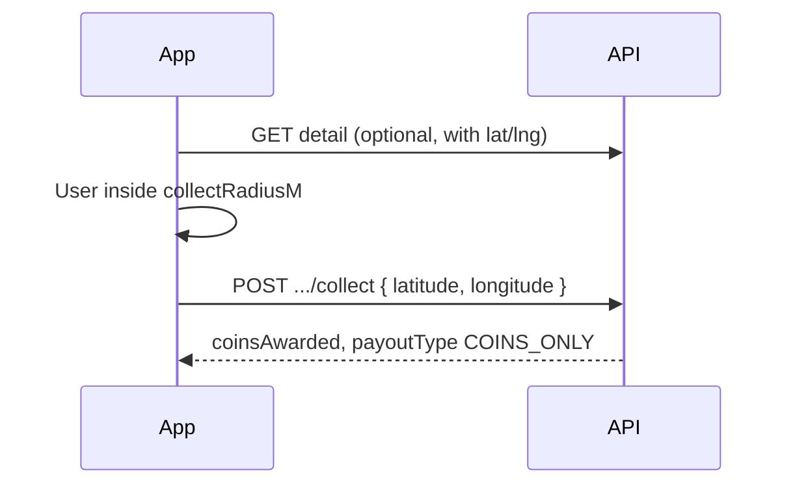
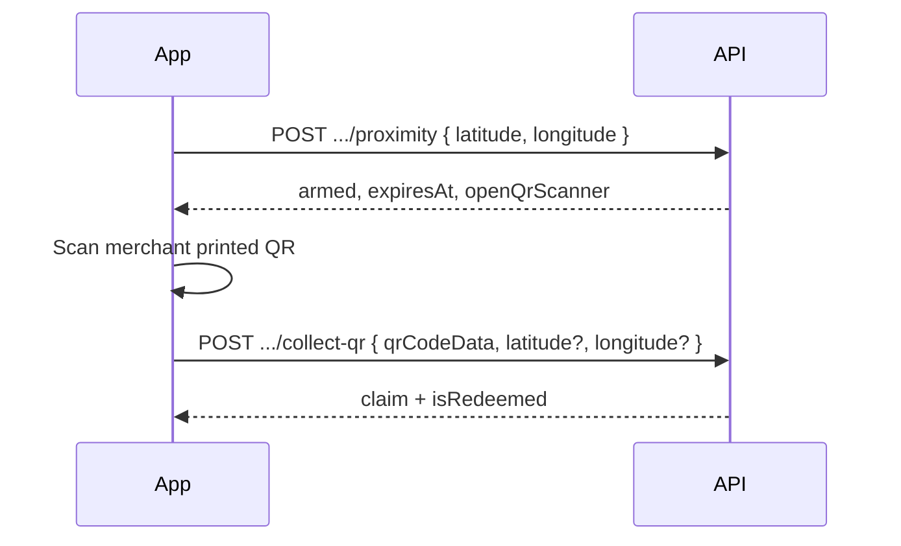

# Silent map drops — mobile developer guide

**Feature:** Single-player pins on the map (not multiplayer live raids).  
**Backend:** `LiveEvent` + `LiveEventClaim` with `displayMode: SILENT_MAP_DROP`.  
**Audience:** Flutter / mobile engineers integrating the Single Player map.

---

## Product: two collection methods (admin chooses at create)

| | **Method 1 — `GPS_INSTANT`** | **Method 2 — `BUSINESS_QR`** |
|---|------------------------------|-------------------------------|
| **Use case** | Street / park “mystery coin” on the map | Drive-to-store restaurant partners |
| **Payout** | **`coinReward`** on pin (admin-set) → **`coinsAwarded`** on collect → player **`raidrCoins`** wallet | **`payoutType: PARTNER_REWARD`** — partner reward label + claim `code` after valid scan |
| **Player UX** | Tap 3D pin → inside GPS radius → **collect instantly** | Tap pin → **verify GPS** → **open in-app QR scanner** → scan printed cashier QR → reward unlocked |
| **Demo (board meeting)** | Optional | **Primary demo flow** at a real restaurant |

**Required mobile flow for Method 2 (QR):**

`Tap map icon` → `POST …/proximity` (GPS) → if `openQrScanner: true`, open camera → `POST …/collect-qr` with scan payload.

GPS does **not** grant the partner reward early — `/collect` on a `BUSINESS_QR` drop is rejected; only coins path uses `/collect`.

**Branch on API fields:** `collectionMethod` and `payoutType` on each pin (`GET dashboard` / detail).

---

## 1. Environments

| Environment | Base URL | Notes |
|-------------|----------|--------|
| **Dev (VPS)** | `http://188.245.72.1:5002/api` | Dev API port **5002** (not 5001). |
| **Prod** | `https://backend-prod.raidr-app.com/api` | Confirm with team before release. |

All routes below are relative to `{BASE_URL}`.

**Auth:** `Authorization: Bearer <user_jwt>` on every call (same as other player APIs).

**Response envelope (typical):**

```json
{ "status": true, "msg": "…", "data": { } }
```

Errors: `{ "status": false, "msg": "<machine-friendly or human text>" }` with HTTP 4xx/5xx.

---

## 2. What this is / is not

| Use | Do not use |
|-----|------------|
| `GET /single-player/dashboard` → `data.silentDrops[]` | `GET /events` (only `LIVE_MULTIPLAYER` raids) |
| `GET/POST …/single-player/silent-drops/*` | `POST /trip/live-event/claim/:eventId` (returns **400** for silent drops) |

**Enums (on each drop):**

- `displayMode`: `SILENT_MAP_DROP`
- `collectionMethod`: `GPS_INSTANT` \| `BUSINESS_QR`
- `collectRadiusM`: integer meters — player must be inside this radius to collect (or to arm QR flow)

**QR secret:** `LiveEvent.qrCode` is **never** returned in list/detail APIs. Merchant prints QR in admin/merchant web; player scans physical QR → send payload as `qrCodeData`.

**One claim per user per drop.** Check `isClaimed` / `hasClaimed` on detail and list items.

---

## 3. API reference (mobile)

| # | Method | Path | Purpose |
|---|--------|------|---------|
| 1 | `GET` | `/single-player/dashboard?latitude=&longitude=&radiusKm=` | Map pins in `data.silentDrops[]` |
| 2 | `GET` | `/single-player/silent-drops/:id?latitude=&longitude=` | Drop detail + distance |
| 3 | `GET` | `/single-player/silent-drops/my-claims` | User's silent-drop claim history |
| 4 | `POST` | `/single-player/silent-drops/:id/collect` | **GPS_INSTANT** collect |
| 5 | `POST` | `/single-player/silent-drops/:id/proximity` | **BUSINESS_QR** — GPS gate, arms scanner **20 min** |
| 6 | `POST` | `/single-player/silent-drops/:id/collect-qr` | **BUSINESS_QR** — after scan |

**Related (optional):** claimed rewards also appear in `GET /rewards/all` under `events` (includes `event.displayMode`).

OpenAPI: merge fragment in repo (`swagger-fragments/silent-map-drops.json`) into `swagger.json`; paths under tag **Silent map drops**.

---

## 4. Discovery (`silentDrops[]` on dashboard — map pins only)

**Request**

```
GET /single-player/dashboard?latitude=33.6844&longitude=73.0479&radiusKm=50
```

`radiusKm` is optional; server default discovery radius is **50 km**.

**Dashboard pin (minimal)** — tap pin → `GET /single-player/silent-drops/:id` for full detail.

| Field | Notes |
|-------|--------|
| `type` | `SILENT_DROP_GPS` or `SILENT_DROP_QR` |
| `id` | Detail / collect routes |
| `title` | Pin label |
| `latitude`, `longitude` | Pin position |
| `mapIconUrl` | 3D / map icon |
| `distanceMeters` | From query lat/lng |
| `hasClaimed` | Grey out if true |
| `coinReward` | **GPS pins only** (optional on pin) |

**Same dashboard response**

| Key | `type` values |
|-----|----------------|
| `dailyDrop` | `DAILY_DROP` or `DAILY_DROP_RARE` (+ `rewardType`, coords, `isCollected`) |
| `zones[]` | `type`: `NORMAL` or `B2B` (zone kind; full object still on dashboard today) |

## 4b. Drop detail (`GET /single-player/silent-drops/:id`)

Full object includes `type`, `description`, `address`, `reward`, `collectRadiusM`, `collectionMethod`, `payoutType`, `coinReward`, times, stock, etc.

---

## 5. Collection flows

### 5.1 GPS_INSTANT (Method 1 — coins only)



**POST** `/single-player/silent-drops/:id/collect`

```json
{ "latitude": 33.6844, "longitude": 73.0479 }
```

**Success `data`:** `claimId`, `coinsAwarded`, `payoutType: "COINS_ONLY"`, `xpEarned: 0` (no partner voucher UI — show coin celebration). `code` is internal/history only.

**Do not** call `/collect` when `collectionMethod === BUSINESS_QR` — use proximity + collect-qr.

---

### 5.2 BUSINESS_QR (Method 2 — restaurant / in-store)

Proximity arm TTL: **20 minutes** (server Redis). After success, open QR scanner until TTL or successful claim.



**Step A — GPS gate**

**POST** `/single-player/silent-drops/:id/proximity`

```json
{ "latitude": 33.6844, "longitude": 73.0479 }
```

**Success example:**

```json
{
  "status": true,
  "msg": "GPS verified",
  "data": {
    "eventId": "…",
    "armed": true,
    "expiresAt": "2026-11-13T18:30:00.000Z",
    "collectionMethod": "BUSINESS_QR",
    "openQrScanner": true,
    "distanceMeters": 42
  }
}
```

**Step B — scan**

**POST** `/single-player/silent-drops/:id/collect-qr`

```json
{
  "qrCodeData": "<exact string from QR>",
  "latitude": 33.6844,
  "longitude": 73.0479
}
```

`latitude` / `longitude` optional if proximity was armed and still within TTL; otherwise server may require GPS near drop again.

**Success `data`:** `claimId`, `code` (show at counter), `xpEarned`, `coinsAwarded`, `isRedeemed`, `payoutType: "PARTNER_REWARD"`.

---

## 6. Claim history

**GET** `/single-player/silent-drops/my-claims`

**Response `data`:** array of:

```json
{
  "claimId": "…",
  "code": "A1B2C3D4",
  "xpEarned": 0,
  "isRedeemed": true,
  "redeemedAt": null,
  "claimedAt": "2026-11-13T12:00:00.000Z",
  "drop": {
    "id": "…",
    "title": "…",
    "description": "…",
    "reward": "…",
    "address": "…",
    "imageUrl": "…",
    "displayMode": "SILENT_MAP_DROP",
    "collectionMethod": "BUSINESS_QR",
    "startTime": "…",
    "endTime": "…"
  }
}
```

---

## 7. Error handling (`msg` and HTTP status)

Handle `status: false` and branch on `msg` (and HTTP code). Common cases:

| HTTP | `msg` (substring / exact) | Client action |
|------|---------------------------|---------------|
| 400 | `alreadyClaimed` | Show already claimed; refresh detail |
| 400 | `soldOut` | Remove or grey out pin |
| 400 | `Too far from drop` | Prompt to move closer; show `collectRadiusM` |
| 400 | `This drop requires in-store QR` | Route to proximity + scanner, not `/collect` |
| 400 | `Complete GPS verification before scanning` | Call `/proximity` first |
| 400 | `Invalid QR Code scanned for this drop` | Wrong QR; retry scan |
| 400 | `This drop is not active yet` / `has expired` | Time window UI |
| 400 | `latitude and longitude are required` | Send GPS on collect/proximity |
| 404 | `Silent drop not found` | Stale map pin; refresh dashboard |

Full messages may include distance text, e.g. `Too far from drop. You are 120m away; must be within 50m.`

---

## 8. UI checklist

- [ ] Map layer: render only `silentDrops[]` from dashboard (separate from multiplayer raid layer).
- [ ] Pin tap → `GET …/silent-drops/:id` with user location for `distanceMeters`.
- [ ] If `hasClaimed` → show code / history; disable collect.
- [ ] Branch on `collectionMethod`: instant GPS button vs “Verify location” then QR.
- [ ] For QR: call `/proximity` only when inside radius; show countdown to `expiresAt` (20 min max).
- [ ] Never call trip live-event claim for these IDs.
- [ ] Optional: sync history tab with `GET …/my-claims`.

---

## 9. Backend / ops (for reference)

- Migration: `prisma/migrations/20261113120000_live_event_silent_drop/migration.sql`  
- **Dev DB:** apply via `docker exec -i raidr_postgres_dev psql …` (not host `.env` pointing at `:5432` on the VPS IP — that is a different Postgres than dev API).
- Web admin/merchant manage drops under `/api/admin/single-player/silent-drops` and `/api/merchant/single-player/silent-drops` (out of scope for mobile).

---

## 10. Quick test (curl)

Replace `TOKEN` and `DROP_ID`.

```bash
BASE=http://188.245.72.1:5002/api
AUTH="Authorization: Bearer TOKEN"

curl -sS -H "$AUTH" "$BASE/single-player/dashboard?latitude=33.68&longitude=73.05" | jq '.data.silentDrops | length'

curl -sS -H "$AUTH" "$BASE/single-player/silent-drops/DROP_ID?latitude=33.68&longitude=73.05" | jq '.data.collectionMethod'
```

---

**Questions:** backend team / `docs/SILENT_MAP_DROPS.md` (internal summary).
